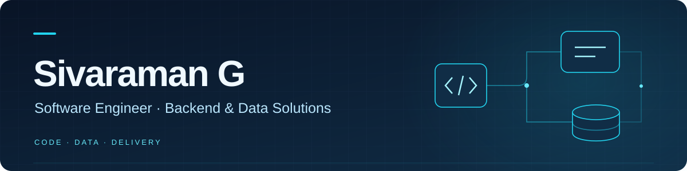

  

  
  

## Building the services behind the workflow

I'm an **Associate Software Engineer at Giant Eagle GCC**, working on backend and data solutions for supply chain operations. My experience includes .NET services, REST APIs, SQL Server, Azure Data Factory pipelines, and build and deployment automation with Azure DevOps.

## What I work with

**Backend**

**Data & integration**

**Delivery & collaboration**

Additional experience with **Azure Databricks**, demand forecasting and Python automation.

## Professional background

- Experience in supply chain software, including labor compliance services, database migration and data integration.
- **AWS Certified Cloud Practitioner** · BTech in Computer Science, Amrita Vishwa Vidyapeetham.

## Public GitHub activity

Public repository activity is one part of my work; the skills above also reflect my professional experience.

[View activity directly on GitHub →](https://github.com/rgsivaraman?tab=overview#year-list-container)

## Let's connect

For professional conversations, find me on [LinkedIn](https://www.linkedin.com/in/sivaraman-g-08a023254/). You can also [explore my public repositories](https://github.com/rgsivaraman?tab=repositories).